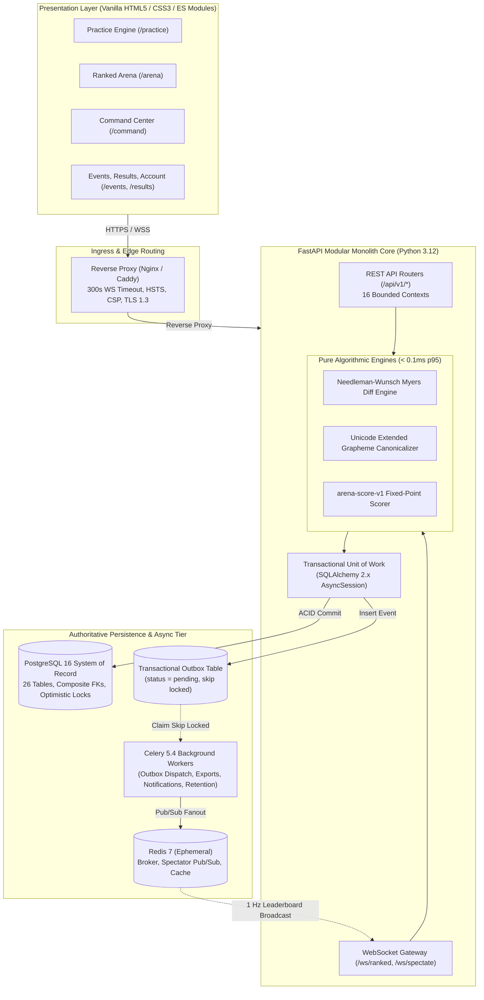
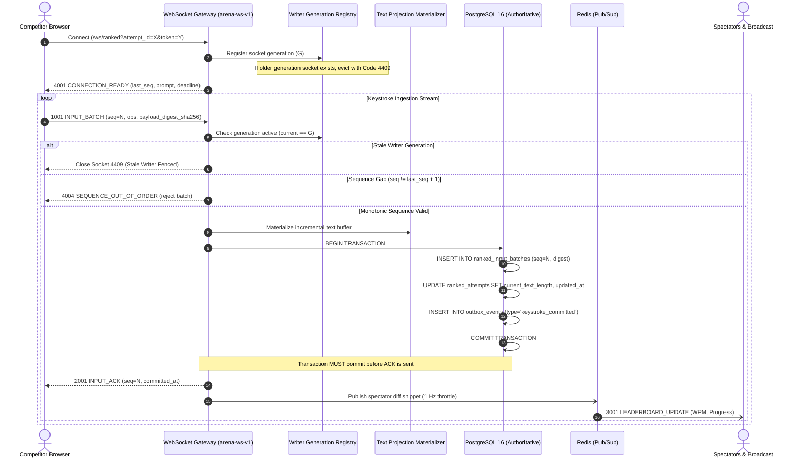
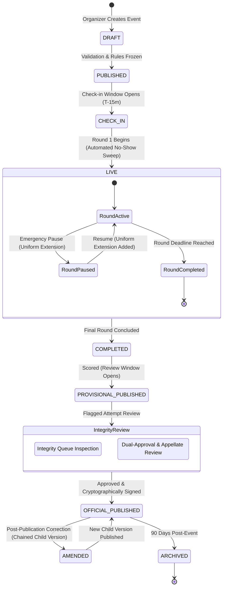
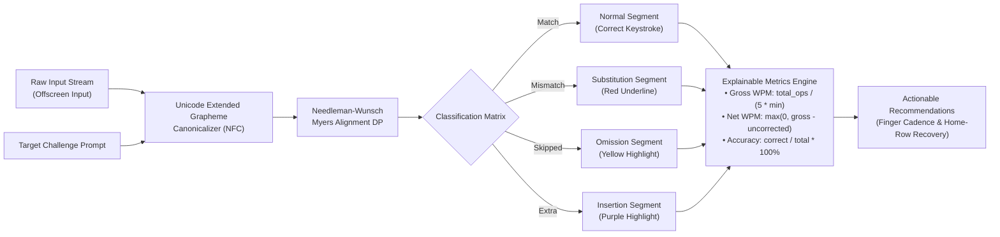
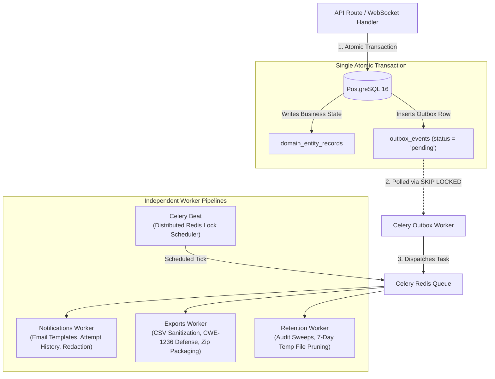

# TypeVector Arena

<div align="center">


-orange)

**An independent, high-integrity typing practice and competitive tournament platform.**  
Server-authoritative keystroke admission • Monotonic sequence gating • Deterministic Myers alignment diff • Fixed-point scoring • Dual-approval integrity reviews • Cryptographically versioned immutable results

</div>

---

## Table of Contents

- [1. Executive Architectural Overview](#1-executive-architectural-overview)
- [2. System Architecture](#2-system-architecture)
- [3. Core Workflows & Lifecycles](#3-core-workflows--lifecycles)
  - [3.1. Ranked Keystroke Ingestion & Input Fencing Workflow](#31-ranked-keystroke-ingestion--input-fencing-workflow)
  - [3.2. Tournament Event Lifecycle State Machine](#32-tournament-event-lifecycle-state-machine)
  - [3.3. Practice Engine & Sequence Alignment Pipeline](#33-practice-engine--sequence-alignment-pipeline)
  - [3.4. Transactional Outbox & Background Processing Pipeline](#34-transactional-outbox--background-processing-pipeline)
- [4. The 16 Bounded Contexts](#4-the-16-bounded-contexts)
- [5. Engineering Invariants & Defense-in-Depth](#5-engineering-invariants--defense-in-depth)
- [6. Operational Documentation & Runbooks](#6-operational-documentation--runbooks)
- [7. Local Quickstart (Development)](#7-local-quickstart-development)
  - [Mode A: Standalone In-Memory (Zero Docker Needed)](#mode-a-standalone-in-memory-zero-docker-needed)
  - [Mode B: Full Infrastructure Stack (Docker Compose)](#mode-b-full-infrastructure-stack-docker-compose)
- [8. Production Deployment & Disaster Recovery](#8-production-deployment--disaster-recovery)
- [9. Testing, Quality Gates & Benchmarks](#9-testing-quality-gates--benchmarks)
- [10. Release Readiness & Pre-Launch Blockers](#10-release-readiness--pre-launch-blockers)

---

## 1. Executive Architectural Overview

TypeVector Arena is engineered for organizations, academic institutions, and competitive communities who demand absolute fairness, transparent rules, and verifiable results.

Unlike conventional typing sites that compute speeds inside client browsers or rely on easily spoofed client-side timestamps, TypeVector Arena enforces **strict server authority**:
- **Zero Client Scoring Authority:** Browsers transmit raw input operations over WebSockets (`arena-ws-v1`). The server materializes projections, runs Unicode grapheme canonicalization, and computes official fixed-point scores (`arena-score-v1`).
- **PostgreSQL as Sole System of Record:** Every keystroke batch, registration seat, state transition, and official result commits to PostgreSQL before an acknowledgment is transmitted to the client.
- **Ephemeral Coordination:** Redis is strictly non-authoritative: used exclusively for pub/sub spectator broadcasts, ephemeral rate limits, and Celery broker queues. If Redis fails, zero competition state is lost.
- **Zero Framework Bloat:** The frontend is built exclusively with semantic HTML5, modern CSS3 custom properties, and vanilla ES modules. There are no virtual DOMs or client framework reconciliation delays during 150+ WPM typing bursts.

---

## 2. System Architecture



---

## 3. Core Workflows & Lifecycles

### 3.1. Ranked Keystroke Ingestion & Input Fencing Workflow

Every keystroke batch submitted during a live tournament round passes through rigorous generation fencing and monotonic sequence admission:



---

### 3.2. Tournament Event Lifecycle State Machine

Events transition through an authoritative state machine protected by monotonic versioning (`version`) to prevent race conditions:



---

### 3.3. Practice Engine & Sequence Alignment Pipeline

The practice typing engine performs real-time Needleman-Wunsch dynamic programming alignment between target prompts and user keystrokes:



---

### 3.4. Transactional Outbox & Background Processing Pipeline

PostgreSQL acts as the transactional buffer for all background asynchronous operations, ensuring zero data loss during Redis broker downtime:



---

## 4. The 16 Bounded Contexts

TypeVector Arena is structured as a **Modular Monolith** with 16 strictly encapsulated domain packages in [`apps/api/src/typevector/domains/`](file:///e:/keyboard/apps/api/src/typevector/domains):

| # | Bounded Context | Core Entity Models | Key API Endpoints | Business Invariants & Responsibilities |
|:---:|:---|:---|:---|:---|
| **01** | `identity` | `User`, `IdentityClaim`, `Session` | `/api/v1/identity/*` | Argon2id hashing, 256-bit server sessions, 3-tier institutional claims, GDPR Art. 16/17 compliance. |
| **02** | `organizations` | `Organization`, `OrganizationMember` | `/api/v1/organizations/*` | Multi-tenant boundaries, RBAC roles (`owner`, `admin`, `judge`, `spectator`), tenant isolation. |
| **03** | `events` | `Event`, `EventRuleset` | `/api/v1/events/*` | Lifecycle state machine (`DRAFT` &rarr; `ARCHIVED`), immutable rulesets, uniform pause fairness extensions. |
| **04** | `registrations` | `EventRegistration` | `/api/v1/registrations/*` | Atomic capacity gating via `SELECT ... FOR UPDATE`, check-in window gating, zero overbooking guarantee. |
| **05** | `rounds` | `Round`, `ChallengePrompt` | `/api/v1/rounds/*` | Composite key referential isolation (`(event_id, round_id)`), pinned challenge prompts, prompt withholding. |
| **06** | `practice` | `PracticeSession` | `/api/v1/practice/*` | 9 distinct practice modes, Needleman-Wunsch sequence diff, standalone in-memory offline evaluation. |
| **07** | `curriculum` | In-memory Skill Catalog | `/api/v1/curriculum/*` | 7 skill tracks, 6 progressive tiers (42 levels), multi-attempt qualification rules ($N \ge 3$), adaptive recommendations. |
| **08** | `ranked_input` | `RankedAttempt`, `RankedInputBatch` | `/ws/ranked`, `/ws/spectate` | Monotonic sequence gating ($S = W + 1$), writer-generation fencing (`4409`), post-commit durable ACKs. |
| **09** | `scoring` | In-memory Scorer Engine | `/api/v1/scoring/*` | Fixed-point `arena-score-v1`, completion threshold gating (&le;699 incomplete, &ge;700 complete), golden vectors. |
| **10** | `results` | `PublishedResult`, `PublishedResultItem` | `/api/v1/results/*` | Cryptographic parent hash chaining (`parent_digest_sha256`), read-only preview, zero PII public standings. |
| **11** | `integrity_review` | `IntegrityCase`, `IntegrityAppeal` | `/api/v1/integrity/*` | Dual-approval reviewer separation for disqualifications, independent appellate adjudication. |
| **12** | `broadcast` | Redis Pub/Sub Adapter | `/ws/spectate` | Ephemeral spectator fanout, 1 Hz throttled leaderboard deltas, origin validation, 1KB frame payload caps. |
| **13** | `notifications` | In-memory Templates & Delivery | `/api/v1/notifications/*` | Truth-in-advertising provider abstraction (`MockNotificationProvider` until SMTP is provisioned). |
| **14** | `exports` | `ExportJob` | `/api/v1/exports/*` | Async CSV/JSON generation, CWE-1236 spreadsheet formula injection sanitization (`sanitize_csv_value`). |
| **15** | `audit` | `AuditEvent` | `/api/v1/audit/*` | Append-only audit trail with recursive secret masking, actor provenance, and tenant scoping. |
| **16** | `operations` | Platform Metrics Collector | `/api/v1/operations/*` | Authentic operational telemetry, connection pool monitoring, None latency when dormant. |

---

## 5. Engineering Invariants & Defense-in-Depth

> [!IMPORTANT]
> **PostgreSQL is the Sole Authority:** All competition state commits to PostgreSQL before client acknowledgment. Redis is strictly ephemeral; broker crashes cause zero data loss.

> [!TIP]
> **Pure Compute Speed:** Needleman-Wunsch diffing ($0.078\text{ ms}$), Unicode canonicalization ($0.016\text{ ms}$), and scoring ($0.051\text{ ms}$) run in $<0.1\text{ ms}$ at p95, ensuring negligible latency overhead.

> [!WARNING]
> **Immutable Results Guarantee:** Official tournament results are never mutated in place. Any retrospective correction produces a cryptographically chained child version referencing the parent SHA-256 digest.

### Summary of Defense Measures

| Vulnerability / Risk | Attack Vector | TypeVector Arena Defense Implementation |
|---|---|---|
| **Registration Race Conditions** | Overbooking capacity via concurrent signups | Pessimistic `SELECT ... FOR UPDATE` row-level lock on event record in single transaction. |
| **Split-Brain WebSocket Typists** | Multiple concurrent tabs submitting strokes | Writer-generation fencing: new connection assigns generation $G+1$ and evicts older socket with code `4409`. |
| **Phantom WebSocket ACKs** | Client receives ACK before DB commit | ACK packet dispatched strictly *after* `session.commit()` completes on PostgreSQL. |
| **Formula Injection (CWE-1236)** | Malicious user names starting with `=+cmd` | `sanitize_csv_value` prepends single quote `'` to all CSV fields starting with `=`, `+`, `-`, `@`, `\t`, `\r`. |
| **Insecure Deserialization (CWE-502)** | Untrusted Celery task payload execution | Enforced JSON-only serializer (`task_serializer = "json"`). Pickle is explicitly banned. |
| **Spectator WebSocket DoS** | Flooding backend with gigantic spectator payloads | 1024-byte payload size caps and strict origin header verification whitelisting production domains. |
| **Public PII Harvesting** | Scraping participant emails and IP addresses | `GET /identity/users/{id}` strictly serves `PublicUserRead`, omitting email, phone, and IP addresses. |

---

## 6. Operational Documentation & Runbooks

- **Release Readiness Audit:** [`docs/release/RELEASE_READINESS_REPORT.md`](file:///e:/keyboard/docs/release/RELEASE_READINESS_REPORT.md) — Evaluation of all 10 Blueprint Gates with CONDITIONAL GO recommendation.
- **Live Event Operations Runbook:** [`docs/operations/LIVE_EVENT_OPERATIONS_RUNBOOK.md`](file:///e:/keyboard/docs/operations/LIVE_EVENT_OPERATIONS_RUNBOOK.md) — 7 incident playbooks for live tournaments.
- **Backup & Disaster Recovery Runbook:** [`docs/operations/BACKUP_AND_RESTORE_RUNBOOK.md`](file:///e:/keyboard/docs/operations/BACKUP_AND_RESTORE_RUNBOOK.md) — Point-in-time recovery and snapshot restoration runbook.
- **Observability & Alerts Specification:** [`docs/operations/OBSERVABILITY_AND_ALERTS.md`](file:///e:/keyboard/docs/operations/OBSERVABILITY_AND_ALERTS.md) — Prometheus metrics, alerting rules, and structured logging.
- **Workload Models & Capacity Targets:** [`docs/testing/WORKLOAD_MODEL_AND_CAPACITY_TARGETS.md`](file:///e:/keyboard/docs/testing/WORKLOAD_MODEL_AND_CAPACITY_TARGETS.md) — Mathematical capacity models and candidate SLOs.
- **Integration & Reliability Report:** [`docs/testing/INTEGRATION_AND_RELIABILITY_REPORT.md`](file:///e:/keyboard/docs/testing/INTEGRATION_AND_RELIABILITY_REPORT.md) — Full test execution evidence across 7 user journeys.
- **Security Control Register:** [`docs/security/SECURITY_CONTROL_REGISTER.md`](file:///e:/keyboard/docs/security/SECURITY_CONTROL_REGISTER.md) — OWASP ASVS technical verification register.

---

## 7. Local Quickstart (Development)

### Prerequisites
- **Node.js:** `>= 20.0.0`
- **pnpm:** `>= 9.0.0`
- **Python:** `>= 3.12.0`
- **uv:** `>= 0.4.0` (Install via `powershell -c "irm https://astral.sh/uv/install.ps1 | iex"` or `curl -LsSf https://astral.sh/uv/install.sh | sh`)
- **Docker Desktop:** (Optional: only required for persistent PostgreSQL and Redis containers)

---

### Mode A: Standalone In-Memory (Zero Docker Needed)

You can launch and use the entire frontend practice engine and public modules immediately without Docker or external databases:

```bash
# 1. Clone & install dependencies
git clone <repo-url>
cd keyboard
pnpm install
uv sync

# 2. Configure local environment
cp .env.example .env

# 3. Start development servers
pnpm dev
```
Open **[http://127.0.0.1:5173/](http://127.0.0.1:5173/)** in your browser. All practice modes, real-time Myers diffing, and curriculum tracks run in standalone mode!

---

### Mode B: Full Infrastructure Stack (Docker Compose)

For complete persistent tournaments, Celery workers, and transactional outbox processing:

```bash
# 1. Start local PostgreSQL and Redis containers
pnpm run infra:up

# 2. Run database migrations
pnpm run db:migrate

# 3. Start development servers
pnpm dev
```

---

## 8. Production Deployment & Disaster Recovery

### Production Docker Compose Stack

The production topology orchestrates the API, Web frontend (Nginx reverse proxy), 4 Celery workers, Celery Beat, PostgreSQL 16, and Redis 7 on an isolated internal data bridge (`tv-data-net`):

```bash
# 1. Create production environment file from template
cp .env.production.template .env.production
# Populate .env.production with production passwords and domain names

# 2. Build and launch hardened non-root container stack
docker-compose -f infra/docker/docker-compose.prod.yml --env-file .env.production up -d --build

# 3. Verify deployment readiness
curl -f http://localhost/readyz
```

### Automated Backup & Restore Execution

- **POSIX Daily Backup:**
  ```bash
  export POSTGRES_PASSWORD="<prod_secret>"
  ./scripts/backup_database.sh
  ```
- **Windows Daily Backup:**
  ```powershell
  $env:POSTGRES_PASSWORD = "<prod_secret>"
  .\scripts\backup_database.ps1
  ```
- **POSIX Restoration Drill:**
  ```bash
  ./scripts/restore_database.sh /backups/postgres/typevector_prod_20261105.dump --confirm
  ```
- **Windows Restoration Drill:**
  ```powershell
  .\scripts\restore_database.ps1 -BackupFile ".\backups\postgres\typevector_prod_20261105.dump" -ConfirmRestore
  ```

---

## 9. Testing, Quality Gates & Benchmarks

| Command | Tool | Description | Result |
|---|---|---|:---:|
| `pnpm test:py` | `pytest` | Full regression test suite | **164 passed, 8 skipped, 0 failures** |
| `pnpm lint:py` | `ruff check` | Python linter across `src/`, `tests/` | **All checks passed** |
| `pnpm format:py:check` | `ruff format` | Code formatting validation | **152 files verified** |
| `pnpm typecheck:py` | `mypy` | Strict static type checking | **0 issues across 122 files** |
| `pnpm --filter @typevector/web build` | `vite build` | Static frontend bundle compilation | **✓ Built in 214ms** |

### Pure Compute Algorithmic Benchmarks (1,000 iterations)

```text
+-----------------------------------------------------------------------------------------+
| Pipeline Component                | p50 Latency  | p95 Latency  | Throughput (ops/sec)  |
+-----------------------------------+--------------+--------------+-----------------------+
| Needleman-Wunsch Myers Diff       | 0.0777 ms    | 0.0968 ms    | 12,274.9 ops/sec      |
| Unicode Grapheme Canonicalization | 0.0163 ms    | 0.0180 ms    | 58,730.6 ops/sec      |
| arena-score-v1 Official Scorer    | 0.0513 ms    | 0.0590 ms    | 18,522.6 ops/sec      |
| Protocol SHA-256 Digest           | 0.0030 ms    | 0.0040 ms    | 304,664.7 ops/sec     |
| Text Projection Materializer      | 0.0018 ms    | 0.0019 ms    | 552,517.4 ops/sec     |
+-----------------------------------------------------------------------------------------+
```

---

## 10. Release Readiness & Pre-Launch Blockers

TypeVector Arena has been audited against all 10 Blueprint Gates and is certified as **Release Candidate RC-1 (CONDITIONAL GO)**.

### Pre-Launch Operational Blocker Register

Prior to hosting live public prize tournaments, platform operators must resolve:

1. **`BLOCKER-01` (Production SMTP Credentials):** Inject valid SMTP credentials into `.env.production` to activate live email notifications (currently running on `MockNotificationProvider`).
2. **`BLOCKER-02` (Multi-Node Staging Load Soak Rehearsal):** Run `python scripts/load_test_harness.py --mode=synthetic` against the deployed staging cluster to verify p95 latency under live multi-node network traffic.
3. **`BLOCKER-03` (Live Staging Backup & Restore Drill):** Execute `scripts/restore_database.sh` on a secondary staging instance to verify byte-for-byte database recovery.
4. **`BLOCKER-04` (Legal Review of Under-18 Participant Policy):** Deliver youth competition and privacy terms to legal counsel for formal written sign-off before opening cash-prize eligibility.

---

<div align="center">
  <sub>Built with craftsmanship by the Antigravity Autonomous Systems Engineering Team.</sub>
</div>
