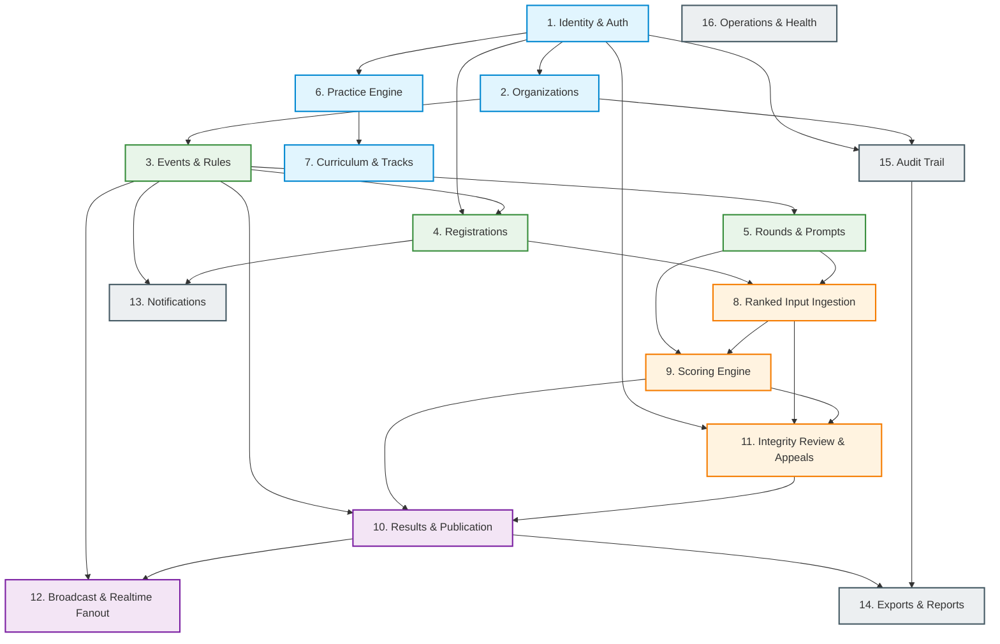

# TypeVector Arena — Domain Boundaries & Modular Monolith Architecture

**Version:** 1.0.0  
**Date:** 2026-11-03  
**Status:** Canonical Architecture Specification  
**Architecture Pattern:** Modular Monolith (Python / FastAPI / SQLAlchemy 2.x / PostgreSQL)  

---

## 1. Architectural Philosophy & Dependency Rules

TypeVector Arena is organized as a **modular monolith** within `apps/api/src/typevector/domains/`. To prevent the architectural degradation common in monolithic systems, the codebase enforces the following strict rules:

1. **Strict Directed Acyclic Graph (DAG):** Circular imports and bi-directional domain dependencies are prohibited.
2. **Encapsulated Data Models:** A domain exclusively owns its database tables and SQLAlchemy models. No domain may directly query, insert, or update models belonging to another domain.
3. **Explicit Service Contracts:** Inter-domain operations must occur exclusively via public domain service interfaces (`services.py`).
4. **Transaction Ownership:** The domain initiating a business transaction owns the database session lifecycle. If cross-domain state must be synchronized asynchronously, it must use the **Transactional Outbox Pattern**. If cross-domain state must be atomic, it is executed via an explicit orchestrator service within a single commit.
5. **No Framework Leaks:** FastAPI HTTP request/response objects, WebSocket session objects, and raw query parameters must remain in routers (`router.py`). Domain services operate exclusively on typed Pydantic schemas or standard Python data structures.

---

## 2. Domain Inventory & Boundary Matrix

| # | Domain Name | Core Purpose | Entities Owned | Transaction Ownership | Upstream Dependencies (Allowed Calls) | Downstream Consumers |
| :--- | :--- | :--- | :--- | :--- | :--- | :--- |
| 1 | **identity** | User accounts, sessions, password hashing, MFA, auth tokens | `User`, `UserSession`, `IdentityClaim`, `VerificationRecord` | Owns auth/account transactions | None (Core Domain) | organizations, events, registrations, practice, curriculum, audit |
| 2 | **organizations** | Multi-tenant organizations, memberships, role assignments | `Organization`, `OrganizationMembership`, `TenantConfig` | Owns org & membership transactions | `identity` | events, registrations, command, audit |
| 3 | **events** | Event definition, versioned rule sets, lifecycle state machine | `Event`, `EventRuleVersion`, `EventLifecycleAudit` | Owns event lifecycle transactions | `organizations`, `identity` | registrations, rounds, scoring, results, broadcast |
| 4 | **registrations** | Event roster, eligibility checks, atomic capacity management | `EventRegistration`, `RegistrationClaim`, `CheckInRecord` | Owns registration & check-in transactions | `events`, `identity`, `organizations` | rounds, ranked_input, broadcast, results |
| 5 | **rounds** | Round configuration, challenge prompt assignment, time limits | `Round`, `ChallengePrompt`, `ChallengePromptVersion` | Owns round setup & prompt versions | `events` | ranked_input, scoring, broadcast |
| 6 | **practice** | Independent practice typing surface, sessions, error diffs | `PracticeSession`, `PracticeAttempt`, `PracticeDiffCache` | Owns practice session transactions | `identity` | curriculum, exports |
| 7 | **curriculum** | Skill tracks, level criteria, multi-attempt qualification | `SkillTrack`, `TrackLevel`, `LevelCriteria`, `UserTrackProgress` | Owns progression & qualification transactions | `practice`, `identity` | exports |
| 8 | **ranked_input** | High-throughput WebSocket ingestion, sequence fencing, ACKs | `RankedAttempt`, `InputBatchLog`, `AttemptTextProjection` | Owns attempt admission & input transactions | `rounds`, `registrations`, `events` | scoring, integrity_review, broadcast |
| 9 | **scoring** | Deterministic metric calculation, canonicalization, vectors | `AttemptScore`, `ScoreRevision`, `ScoreCanonicalProfile` | Owns score computation transactions | `ranked_input`, `rounds`, `events` | results, integrity_review |
| 10 | **results** | Result aggregation, immutable published versions, amendments | `PublishedResultVersion`, `RankRow`, `ResultAmendment` | Owns publication & amendment transactions | `scoring`, `events`, `rounds` | broadcast, exports |
| 11 | **integrity_review**| Review flags, human judging rationale, participant appeals | `IntegrityCase`, `IntegritySignal`, `AppealRecord`, `ReviewerDecision` | Owns review & appeal transactions | `ranked_input`, `scoring`, `events`, `identity` | results, audit |
| 12 | **broadcast** | Ephemeral fanout, WebSocket subscriptions, spectator feed | `RedisPubSubBridge`, `SpectatorCacheSnapshot` | Non-authoritative (Read-only / Cache) | `events`, `rounds`, `results` | External WebSocket clients |
| 13 | **notifications** | Transactional email, system alerts, deliverability tracking | `NotificationDelivery`, `NotificationTemplate` | Owns delivery queue transactions | `identity`, `events` | Celery workers |
| 14 | **exports** | Async report generation (CSV/JSON), formula injection guard | `ExportJob`, `ExportArtifactMetadata` | Owns export lifecycle transactions | `events`, `registrations`, `results`, `audit` | Celery workers, command center |
| 15 | **audit** | Append-only privileged action log, tenant compliance | `AuditEvent`, `AuditArchiveIndex` | Owns audit append transactions | `identity`, `organizations` | command center, platform operators |
| 16 | **operations** | Platform health checks, DB pool metrics, Redis latency | `SystemHealthSnapshot`, `WorkerHeartbeat` | Read-only operational metrics | System infrastructure | Operators, Prometheus/Grafana |

---

## 3. Visual Domain Dependency Flow (DAG)



---

## 4. Key Cross-Domain Invariants & Integration Patterns

### 4.1. Single-Transaction Ranked Input Admission
When a participant submits an `INPUT_BATCH` over WebSocket:
1. `ranked_input.service` validates:
   - Attempt state is `ACTIVE`.
   - Writer generation matches the active socket session.
   - Sequence number is exactly `expected_watermark + 1`.
   - Batch size and operation count do not exceed configured limits.
2. Inside an atomic PostgreSQL transaction:
   - Append immutable row to `ranked_input_batch_log`.
   - Update `ranked_attempt` text projection, sequence watermark, and checksum.
   - Insert state event to `outbox_events` (if fanout is triggered).
3. On transaction commit:
   - Dispatch `INPUT_ACK` back to client over WebSocket.
   - If commit fails, return `INPUT_REJECTED` with specific recovery watermark.

### 4.2. Composite Cross-Event Isolation Constraints
To guarantee at the schema level that cross-event data corruption cannot occur:
- `rounds` table has a composite primary/unique key: `(id, event_id)`.
- `registrations` table has a composite primary/unique key: `(id, event_id)`.
- `ranked_attempts` enforces composite foreign keys:
  - `FOREIGN KEY (round_id, event_id) REFERENCES rounds(id, event_id)`
  - `FOREIGN KEY (registration_id, event_id) REFERENCES registrations(id, event_id)`
This mathematically prevents an attempt from referencing a round in Event 1 while being registered in Event 2.

### 4.3. Transactional Outbox Pattern for Async Dispatch
To prevent dual-write inconsistencies between PostgreSQL and Redis/Celery:
```
[Domain Service] 
     │
     ▼ (Atomic Commit)
┌──────────────────────────────────────────────┐
│ PostgreSQL                                   │
│  ├── [Domain Table: e.g. results_published]  │
│  └── [outbox_events: event payload & topic]  │
└──────────────────────────────────────────────┘
     │
     ▼ (Polled / Streamed by Outbox Worker)
[Outbox Dispatcher Daemon]
     │
     ▼ (Publish)
┌──────────────────────────────────────────────┐
│ Redis Pub/Sub & Celery Task Queues           │
└──────────────────────────────────────────────┘
```
If Redis is temporarily down, PostgreSQL outbox rows accumulate without failure. Once Redis reconnects, all pending messages are delivered in strict commit sequence.

