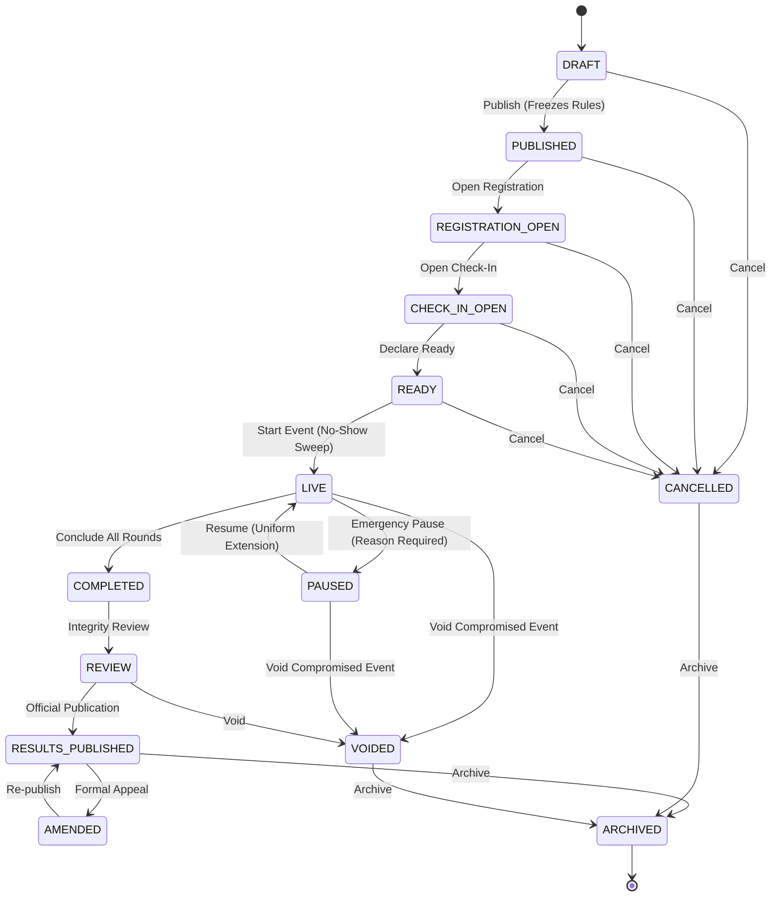

# ADR-011: Event Lifecycle State Machine, Check-in Windows, Round Orchestration, and Uniform Pause Fairness

**Status:** Accepted  
**Date:** 2026-11-04  
**Deciders:** Principal Product Architect & Technical Lead  
**Consulted:** Engineering Team, Tournament Integrity Reviewers  
**Informed:** Platform Operators, UI Engineers, Competition Organizers  

---

## Context & Problem Statement

Multi-round tournament integrity requires an explicit, auditable, and server-controlled lifecycle. Traditional esports and competitive platforms frequently suffer from:
1. **Ad-Hoc State Mutations:** Database status fields modified directly without role validation, precondition verification, or audit logging.
2. **Organizer Race Conditions:** Concurrent clicks from multiple co-organizers causing double starts, duplicate round transitions, or conflicting state overrides.
3. **Selective / Participant-Specific Extensions:** Adding extra time for individual participants who report local latency or technical glitches fatally compromises tournament fairness.
4. **Unsynchronized Timekeeping:** Reliance on client clocks for round countdowns, start signals, or deadline enforcement.
5. **Coupled Redis Dependencies:** Realtime spectator distribution tightly coupled to database transactions such that a Redis failure corrupts or aborts PostgreSQL commits.
6. **Rule Drift:** Rulesets, durations, or challenge prompt texts altered after an event is announced or during live competition.

---

## Decision Drivers

1. **Deterministic Lifecycle Table:** Every transition must evaluate source state, target state, actor roles, preconditions, and reason requirements. Deny by default.
2. **Optimistic Locking (`version`):** Both `Event` and `Round` maintain an integer version counter. Stale requests must be rejected with HTTP 409 Conflict.
3. **Precondition & Ruleset Immutability:** Event rulesets and round prompts freeze upon leaving `DRAFT`. Modification in `PUBLISHED` or subsequent states is strictly prohibited.
4. **Uniform Fairness Invariant:** Any event-wide incident pause of duration $\Delta t$ uniformly extends deadlines across all active rounds and participant attempts ($\text{deadline} \leftarrow \text{deadline} + \Delta t$). Participant-specific extensions are architecturally impossible.
5. **Server Clock Authority:** Server NTP epoch sampling endpoint (`GET /api/v1/arena/clock`) with guaranteed uncertainty bound ($\le 5\text{ms}$).
6. **Transactional Outbox & Ephemeral Fanout:** PostgreSQL owns authoritative state. Outbox events are dispatched to Redis pub/sub asynchronously; Redis downtime never fails domain operations.
7. **Input ACK Prioritization:** Spectator leaderboard updates are throttled to 1 Hz max to ensure zero resource contention with participant input ACKs.

---

## Architectural & Lifecycle Specifications

### 1. Authoritative Event State Machine

The event lifecycle progresses through defined stages:

### 2. Preconditions & State Transitions

| Transition | Allowed Roles | Preconditions & Actions |
|---|---|---|
| `DRAFT` &rarr; `PUBLISHED` | `org_admin`, `platform_admin` | Requires &ge;1 ruleset, &ge;1 round, and &ge;1 active challenge prompt. Freezes ruleset immutability. |
| `REGISTRATION_OPEN` &rarr; `CHECK_IN_OPEN` | `org_admin`, `platform_admin` | Activates participant check-in window. |
| `CHECK_IN_OPEN` &rarr; `READY` | `org_admin`, `platform_admin` | Confirms check-ins; allows readiness signals (`mark_participant_ready`). |
| `READY` &rarr; `LIVE` | `org_admin`, `platform_admin` | Automated sweep flags un-checked-in confirmed registrations as `no_show`. |
| `LIVE` &rarr; `PAUSED` | `org_admin`, `platform_admin` | Mandatory audited reason. Sets `pause_started_at` on event and freezes active rounds. |
| `PAUSED` &rarr; `LIVE` | `org_admin`, `platform_admin` | Computes $\Delta t = \text{now} - \text{pause\_started\_at}$. Uniformly extends `rounds.deadline_at` and active `ranked_attempts.deadline_at`. |
| `LIVE` &rarr; `COMPLETED` | `org_admin`, `platform_admin` | Concludes live round submissions. |
| `COMPLETED` &rarr; `REVIEW` | `org_admin`, `platform_admin` | Begins integrity checks and telemetry verification. |
| `REVIEW` &rarr; `RESULTS_PUBLISHED` | `org_admin`, `platform_admin` | Emits official, immutable tournament standings. |
| Any active &rarr; `VOIDED` | `platform_admin` | Material compromise policy; voids event and marks active rounds and attempts voided. |

### 3. Tournament Fairness Policy (Draft Specification)

- **Policy Designation:** `FAIRNESS_POLICY_STATUS = "DRAFT_AWAITING_TOURNAMENT_APPROVAL"`
- **Maximum Pause Count:** `MAX_PAUSES_PER_ROUND = 2`
- **Maximum Total Pause Duration:** `MAX_PAUSE_DURATION_SECONDS = 600` (10 minutes).
- **Enforcement:** If cumulative pause duration exceeds 600 seconds, the event cannot be resumed automatically and must be flagged for tournament committee voiding or formal review.

---

## Consequences

### Positive
- Strict server control prevents unauthorized state mutations, duplicate starts, or race conditions between organizers.
- Zero participant-specific extensions eliminates favoritism and guarantees provable fairness.
- Decoupling PostgreSQL from Redis via `TransactionalOutbox` guarantees zero database transaction aborts when Redis is unavailable.
- Check-in window and automated no-show sweeps provide reliable participant counts prior to round start.

### Negative / Trade-offs
- Organizers must strictly follow the transition sequence; skipping directly from `DRAFT` to `LIVE` is rejected.
- Resuming a paused event performs a batch update across active attempts and rounds within an ACID transaction.

